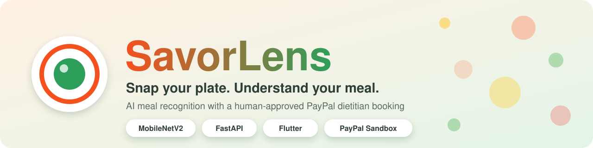
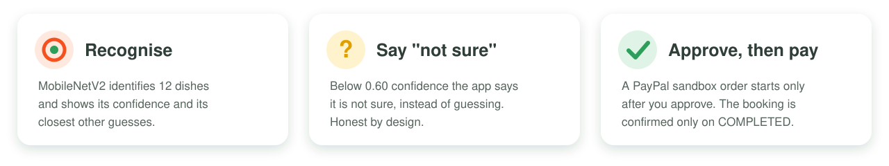
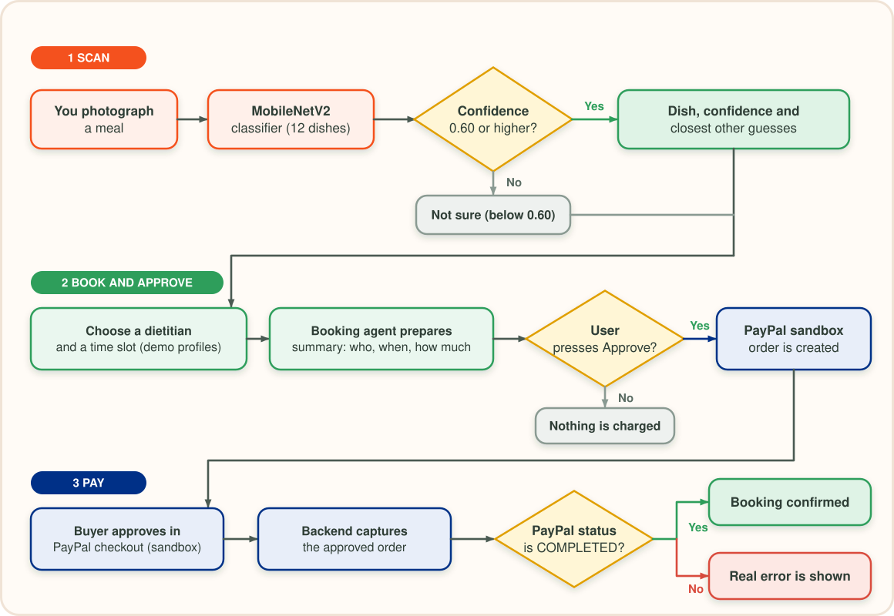
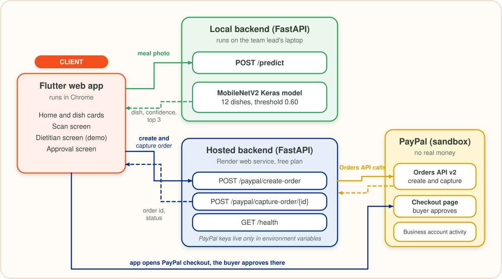
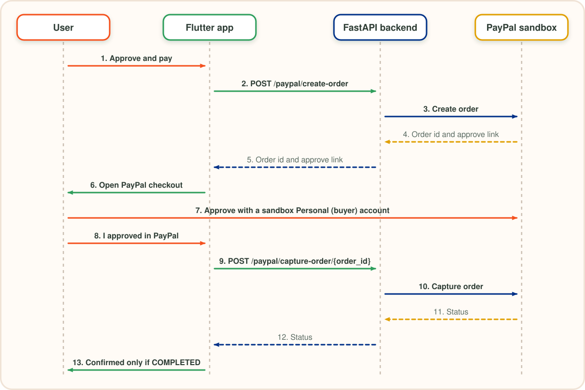

<p align="center">
  
</p>

<p align="center">
  
  
  
  
  
  
</p>

<p align="center">
  <a href="#getting-started"></a>
  <a href="#user-flow"></a>
  <a href="#architecture"></a>
  <a href="docs/API.md"></a>
  <a href="docs/MODEL_CARD.md"></a>
  <a href="https://www.kaggle.com/code/ailanasirai/savorlens-food-classifier"></a>
</p>

<h3 align="center">Photograph a meal. AI recognises the dish. An agent prepares a dietitian booking.<br>PayPal payment happens only after you approve it.</h3>

<p align="center">Built for the <b>PayPal AI Hackathon</b> on Devpost by <b>Aila Nasir</b> and <b>Ekeu David</b>.</p>

<p align="center">
  
</p>

## Contents

1. [Why SavorLens](#why-savorlens)
2. [Screenshots](#screenshots)
3. [User flow](#user-flow)
4. [Architecture](#architecture)
5. [How PayPal is used](#how-paypal-is-used)
6. [How AI is used](#how-ai-is-used)
7. [Project status](#project-status)
8. [Honest limits](#honest-limits)
9. [Getting started](#getting-started)
10. [Testing a payment](#testing-a-payment)
11. [Documentation](#documentation)
12. [Roadmap](#roadmap)
13. [Team](#team) and [Credits](#credits)

## Why SavorLens

People photograph their meals all the time, but a photo alone gives no guidance. Getting from "what is on my plate?" to "I should talk to a dietitian" takes many steps: find one, compare, book, pay. AI food apps also tend to guess with confidence even when they are wrong.

SavorLens shrinks those steps into one flow and is built around one rule:

> [!IMPORTANT]
> **The AI can recognise and prepare, but only the person can approve a payment.** If the model is not confident, it says "not sure" instead of guessing.

| | What the app does |
|---|---|
| **Recognise** | A MobileNetV2 classifier identifies one of 12 dishes and shows its confidence and the closest other guesses. |
| **Be honest** | Below a confidence of 0.60 the app answers "not sure". Nutrition shows "not measured yet" instead of invented numbers. |
| **Book** | The user picks a dietitian and a time slot. A rule-based booking agent prepares a summary: who, when, how much. |
| **Approve** | Nothing is charged until the user presses "Approve and pay". |
| **Pay** | A PayPal sandbox order is created and captured. The booking is confirmed only if PayPal returns `COMPLETED`. |

## Screenshots

<table>
  <tr>
    <td align="center" width="50%"><br><sub><b>Home</b>: start by scanning a meal</sub></td>
    <td align="center" width="50%"><br><sub><b>Scan result</b>: dish, confidence and other guesses (gyoza)</sub></td>
  </tr>
  <tr>
    <td align="center"><br><sub><b>Scan result</b>: pizza</sub></td>
    <td align="center"><br><sub><b>Scan result</b>: hamburger</sub></td>
  </tr>
  <tr>
    <td align="center"><br><sub><b>"Not sure"</b>: a dish outside the 12 the model knows</sub></td>
    <td align="center"><br><sub><b>Care for you</b>: choose how to get dietitian help</sub></td>
  </tr>
  <tr>
    <td align="center"><br><sub><b>Dietitians</b>: clearly labelled demo profiles and time slots</sub></td>
    <td align="center"><br><sub><b>Approval</b>: who, when and how much, before anything is charged</sub></td>
  </tr>
</table>

<!-- Add after the PayPal test: docs/screenshots/09-paypal-activity.png (sandbox business account activity, emails and balances hidden) -->

### Real scan examples

These are real photos tested on the model. Numbers are the confidence the app showed.

| Photo | Result | Why |
|---|---|---|
| Gyoza | Gyoza, 91% | One of the 12 dishes |
| Pizza | Pizza, 65% | One of the 12 dishes |
| Shawarma wrap | **Not sure** (best guess Tacos 59%, then Samosa 23%) | Shawarma is not one of the 12 dishes, and 59% is below the 0.60 threshold, so the app does not guess |

## User flow

<p align="center">
  <a href="docs/diagrams/user-flow.svg"></a>
</p>

## Architecture

<p align="center">
  <a href="docs/diagrams/architecture.svg"></a>
</p>

- The **Flutter web app** is the only thing the user touches.
- The **scan backend** (`POST /predict`) runs locally, because the food model is not deployed on the free Render plan.
- The **payment backend** runs on **Render**. If the model code is missing, `/predict` switches itself off and the PayPal endpoints keep working. `/health` reports this as `predict_enabled`.
- PayPal keys live only in environment variables (Render) and a local `backend/.env`. They are never committed.

More detail is in [docs/ARCHITECTURE.md](docs/ARCHITECTURE.md).

### Payment sequence

<p align="center">
  <a href="docs/diagrams/payment-sequence.svg"></a>
</p>

## How PayPal is used

- **PayPal Orders API v2**, sandbox environment only. No real money is used.
- After the user approves a booking, the FastAPI backend creates a PayPal order. The user approves it in PayPal checkout with a sandbox buyer account. The backend then captures the order.
- The booking is confirmed **only if PayPal returns `COMPLETED`**. Real errors are shown, not hidden.
- PayPal keys live only in environment variables, never in this repository.

**What we tested:** with the sandbox buyer approving in a private window, the capture call returned `COMPLETED` (order `9H430629DV129491T`), and two $10.00 USD payments appear in the sandbox business account activity.

## How AI is used

- **Dish recognition:** MobileNetV2 (TensorFlow/Keras), transfer learning on Food-101, 12 dishes: pizza, sushi, ramen, tacos, lasagna, hamburger, fried rice, pad thai, pancakes, hummus, samosa, gyoza.
- **Honest confidence:** below a threshold of 0.60 the app answers "not sure". The threshold was chosen on validation data.
- **Booking agent step:** the booking summary (who, when, how much) is prepared by a **rule-based** step. It does not use a language model.
- Training notebook: [SavorLens Food Classifier on Kaggle](https://www.kaggle.com/code/ailanasirai/savorlens-food-classifier). Full details: [docs/MODEL_CARD.md](docs/MODEL_CARD.md).

### Measured results

| Metric | Value |
|---|---|
| Validation accuracy | 82.2% |
| Test accuracy (3,000 held-out photos) | **84.7%** |
| Photos answered at threshold 0.60 | 83% |
| Accuracy on the photos it answers | 92.5% |

Known weakness: hummus is over-predicted, and tacos, pancakes and ramen get mixed up. All numbers come from a test set the model never saw during training. A single photo can show a very high confidence, but that is not the accuracy of the model.

## Project status

| Feature | Status |
|---|---|
| Dish recognition for 12 dishes with confidence and top guesses | Working |
| "Not sure" answer below the 0.60 threshold | Working |
| Dietitian booking screens | Working, with demo profiles |
| Approval summary before any payment | Working |
| PayPal sandbox create and capture (Swagger, local backend) | Working, `COMPLETED` reached |
| PayPal on the hosted Render backend, and the app's Approve button end to end | Being re-tested |
| Real dietitians, licence verification, nutrition estimates | Planned |

## Honest limits

> [!NOTE]
> SavorLens is a hackathon prototype and not medical advice.

- The six dietitian profiles are **demo profiles**. Real dietitian onboarding with licence verification is future work.
- Payments run in the **PayPal sandbox** only.
- Nutrition values show "not measured yet". We do not invent numbers.
- The model knows 12 dishes. Dishes outside them (for example shawarma, biryani, karahi) end as "not sure".
- The free AI coach button is a placeholder.

## Getting started

**Requirements:** Python 3.10 or newer, the Flutter SDK, and a PayPal Developer sandbox app (client id and secret).

### 1. Backend

```bash
cd backend
python -m venv venv
venv\Scripts\activate
pip install -r requirements.txt
copy .env.example .env
uvicorn main:app --reload --port 8000
```

Open `http://127.0.0.1:8000/health`. You should see `{"status":"ok","predict_enabled":true}`.

Fill `backend/.env` with your own sandbox values:

```
PAYPAL_CLIENT_ID=your_sandbox_client_id
PAYPAL_CLIENT_SECRET=your_sandbox_client_secret
PAYPAL_BASE_URL=https://api-m.sandbox.paypal.com
```

For a PayPal-only setup without TensorFlow, install `requirements-paypal.txt` instead. `/predict` is then disabled and `/health` shows `predict_enabled: false`.

### 2. Flutter app

```bash
cd app
flutter pub get
flutter run -d web-server --web-port 8080
```

Open `http://localhost:8080` in Chrome.

- The scan screen calls `http://localhost:8000/predict` (your local backend).
- The approval screen calls the hosted payment backend at `https://savorlens.onrender.com`. It runs on a free plan, so the first request can take about a minute to wake up. Open `/health` first to wake it up.

## Testing a payment

> [!TIP]
> Use a PayPal sandbox **Personal** (buyer) account at checkout, ideally in a private window and with "Pay in full" (not "Pay in 4"). Logging in with the sandbox Business account shows a "merchant account" error.

You can also test the payment without the app, from the interactive API page at `/docs`:

1. Run `POST /paypal/create-order` and copy the `order_id` and the approve link from the response.
2. Open the approve link in a private window and approve with the sandbox buyer account.
3. Run `POST /paypal/capture-order/{order_id}` with the same order id. The status should be `COMPLETED`.

<!-- Add the judge sandbox buyer note here after Ekeu David creates that account. -->

## Documentation

| Document | What is inside |
|---|---|
| [docs/ARCHITECTURE.md](docs/ARCHITECTURE.md) | Components, design decisions, deployment and data flow |
| [docs/API.md](docs/API.md) | Every endpoint, example calls, environment variables and common errors |
| [docs/MODEL_CARD.md](docs/MODEL_CARD.md) | Dataset, training, metrics, real examples, limits and intended use |

## Tech stack

| Layer | Technology |
|---|---|
| App | Flutter (web) |
| Backend | FastAPI (Python) |
| AI model | MobileNetV2, TensorFlow/Keras, transfer learning on Food-101 |
| Payments | PayPal Orders API v2 (sandbox) |
| Hosting | Render (payment backend) |
| Training | Kaggle notebook |

## Project structure

```
SavorLens/
  app/          Flutter web app (scan, dietitian and approval screens)
  backend/      FastAPI backend (PayPal endpoints and /predict)
    model/      MobileNetV2 Keras model and model_report.json
  docs/
    ARCHITECTURE.md
    API.md
    MODEL_CARD.md
    banner.svg
    highlights.svg
    diagrams/   user-flow, architecture and payment-sequence diagrams
    screenshots/
  LICENSE       MIT
```

## Roadmap

- Pakistani dishes (karahi, nihari, haleem, seekh kabab, biryani) trained from our own photo dataset
- Nutrition estimates with a clear, cited source
- Real dietitian onboarding with licence verification
- Hosting the scan model so the whole flow runs from one public link

These are planned, not built yet.

## Team

| | |
|---|---|
| **Aila Nasir** (team lead) | Flutter app, backend and AI model |
| **Ekeu David** | PayPal developer account, sandbox setup, testing and backend deployment on Render |

## Credits

- Training images: [Food-101](https://data.vision.ee.ethz.ch/cvl/datasets_extra/food-101/) (Bossard et al.), used through the Kaggle mirror `kmader/food41`, for training and evaluation only.
- Dish photos shown in the app come from Pixabay contributors.
- Built with Flutter, FastAPI, TensorFlow/Keras, the PayPal Orders API and Render.
- AI assistants were used as helpers: Claude (Anthropic) for coding help, debugging and writing support, and Gemini (Google) to generate the project thumbnail. Design decisions, testing and integration were done by the team.

## License

Released under the [MIT License](LICENSE).
