# SavorLens

**Photograph a meal. AI recognises the dish. An agent prepares a dietitian booking. PayPal payment happens only after you approve it.**


Built for the **PayPal AI Hackathon** on Devpost by Aila Nasir and David Ekeu.

SavorLens is built around one rule: **the AI can recognise and prepare, but only the person can approve a payment.** If the model is not confident, it says "not sure" instead of guessing.

## Screenshots

| Home | Scan: gyoza | Scan: burger |
|---|---|---|
| 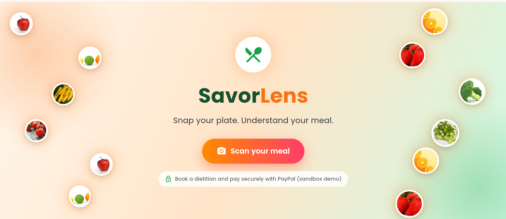 | 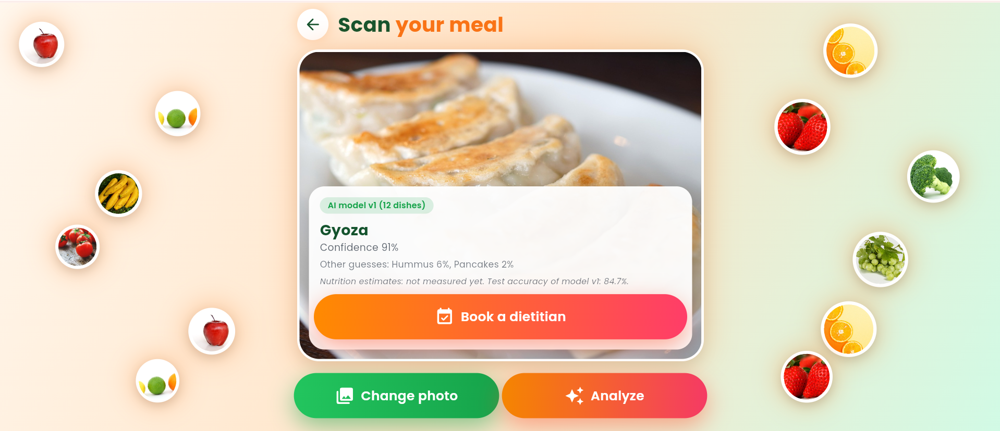 | 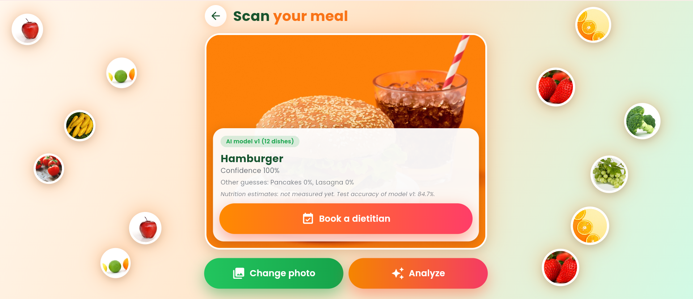 |

| Scan: pizza | "Not sure" | Dietitian care |
|---|---|---|
| 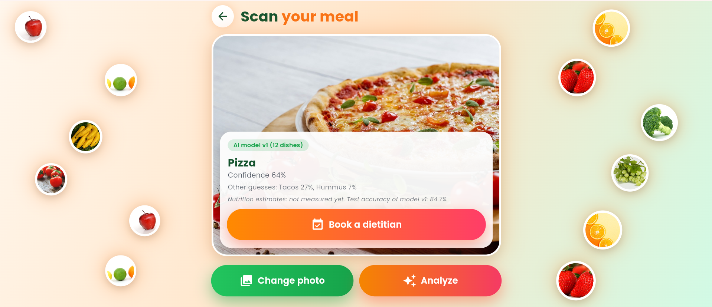 | 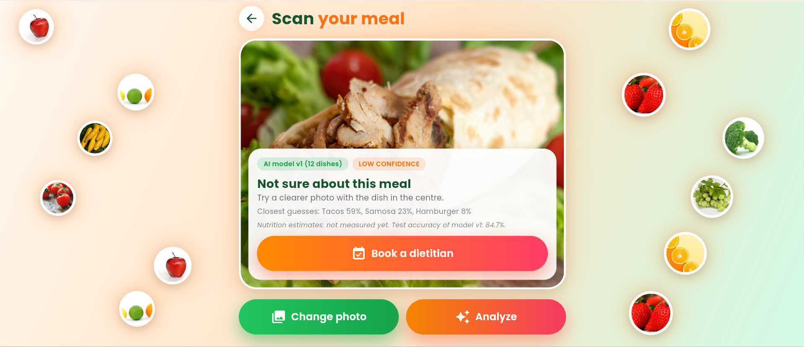 | 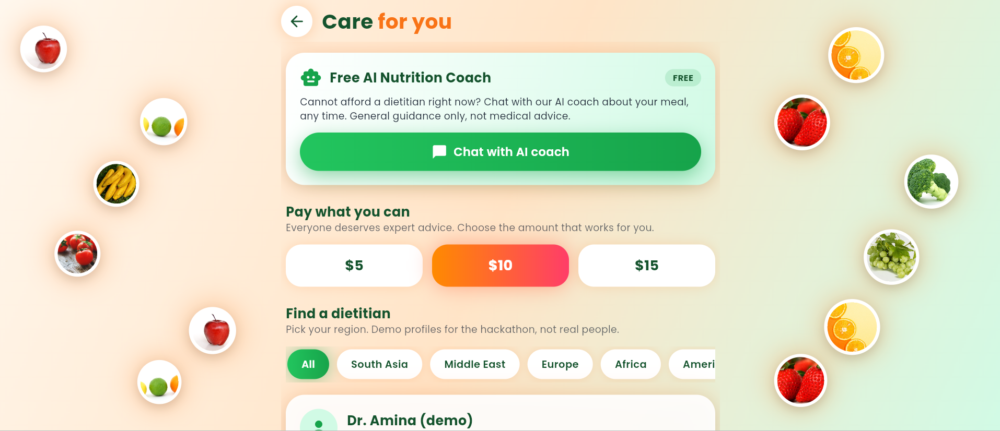 |

| Demo dietitians | Approval |
|---|---|
| 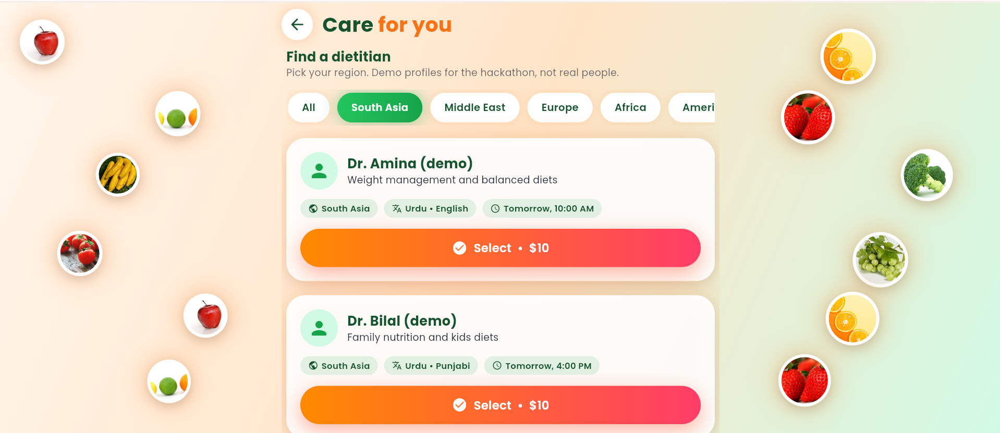 | 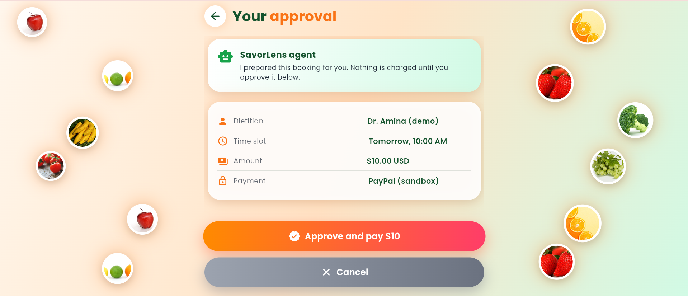 |

## How it works

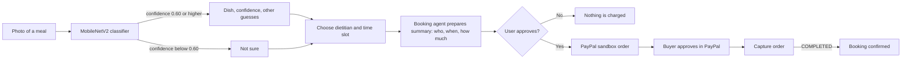

## Architecture

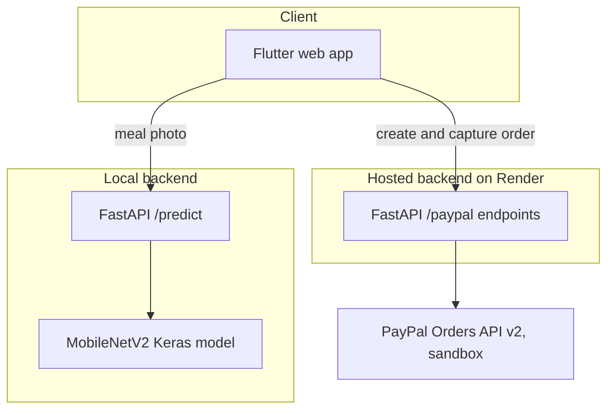

The payment backend runs on Render. The scan endpoint (`/predict`) runs on the local backend, because the food model is not deployed to the free Render plan. If the model code is missing, `/predict` is switched off and the PayPal endpoints keep working (`/health` reports `predict_enabled`).

### Payment sequence

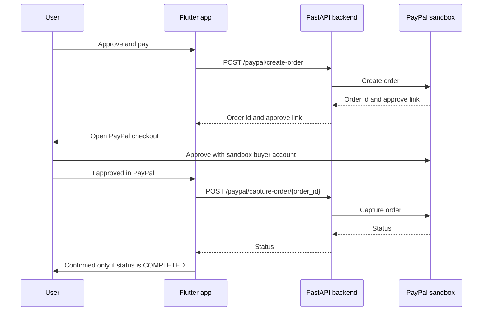

## How PayPal is used

- **PayPal Orders API v2**, sandbox environment only. No real money is used.
- After the user approves a booking, the FastAPI backend creates a PayPal order. The user approves it in PayPal checkout with a sandbox buyer account. The backend then captures the order.
- The booking is confirmed **only if PayPal returns `COMPLETED`**. Real errors are shown, not hidden.
- PayPal keys live only in environment variables (Render) and a local `backend/.env`. They are never committed.

## How AI is used

- **Dish recognition:** MobileNetV2 (TensorFlow/Keras), transfer learning on Food-101, 12 dishes: pizza, sushi, ramen, tacos, lasagna, hamburger, fried rice, pad thai, pancakes, hummus, samosa, gyoza.
- **Honest confidence:** below a threshold of 0.60 the app answers "not sure". The threshold was chosen on validation data.
- **Booking agent step:** the booking summary (who, when, how much) is prepared by a **rule-based** step. It does not use a language model.
- Training notebook: [SavorLens Food Classifier on Kaggle](https://www.kaggle.com/code/ailanasirai/savorlens-food-classifier)

### Measured results

| Metric | Value |
|---|---|
| Validation accuracy | 82.2% |
| Test accuracy (3,000 held-out photos) | 84.7% |
| Photos answered at threshold 0.60 | 83% |
| Accuracy on the photos it answers | 92.5% |

Known weakness: hummus is over-predicted, and tacos, pancakes and ramen get mixed up. All numbers come from a test set the model never saw during training.

## Honest limits

- The six dietitian profiles are **demo profiles**. Real dietitian onboarding with licence verification is future work.
- Payments run in the **PayPal sandbox** only.
- Nutrition values show "not measured yet". We do not invent numbers.
- The model knows 12 dishes. Dishes outside them (for example shawarma or biryani) end as "not sure".
- The free AI coach button is a placeholder.
- SavorLens is not medical advice.

## Getting started

**Requirements:** Python 3.10 or newer, Flutter SDK, and a PayPal Developer sandbox app (client id and secret).

### 1. Backend

```bash
cd backend
python -m venv venv
venv\Scripts\activate
pip install -r requirements.txt
copy .env.example .env
uvicorn main:app --reload --port 8000
```

Open `http://127.0.0.1:8000/health`. You should see `{"status":"ok","predict_enabled":true}`.

Fill `backend/.env` with your own sandbox values:

```
PAYPAL_CLIENT_ID=your_sandbox_client_id
PAYPAL_CLIENT_SECRET=your_sandbox_client_secret
PAYPAL_BASE_URL=https://api-m.sandbox.paypal.com
```

For a PayPal-only setup without TensorFlow, install `requirements-paypal.txt` instead. `/predict` is then disabled and `/health` shows `predict_enabled: false`.

### 2. Flutter app

```bash
cd app
flutter pub get
flutter run -d web-server --web-port 8080
```

Open `http://localhost:8080` in Chrome.

- The scan screen calls `http://localhost:8000/predict` (your local backend).
- The approval screen calls the hosted payment backend at `https://savorlens.onrender.com`. It runs on a free plan, so the first request can take about a minute to wake up.

### 3. Testing a payment

Use a PayPal sandbox **Personal** (buyer) account at checkout, ideally in a private window and with "Pay in full" (not "Pay in 4"). Logging in with the sandbox Business account shows a "merchant account" error.

<!-- Add the judge sandbox buyer note here after David creates that account. -->

## Backend endpoints

| Method | Path | Purpose |
|---|---|---|
| GET | `/health` | Status and whether `/predict` is enabled |
| POST | `/predict` | Meal photo in, dish, confidence, top 3 and threshold out |
| POST | `/paypal/create-order` | Create a PayPal sandbox order |
| POST | `/paypal/capture-order/{order_id}` | Capture an approved order |

## Project structure

```
SavorLens/
  app/        Flutter web app (scan, dietitian and approval screens)
  backend/    FastAPI backend (PayPal endpoints and /predict)
    model/    MobileNetV2 Keras model and model_report.json
  docs/
    screenshots/
  LICENSE     MIT
```

## Team

- **Aila Nasir** (team lead): Flutter app, backend and AI model.
- **David Ekeu**: PayPal developer account, sandbox setup, testing and backend deployment on Render.

## Credits

- Food images for training: [Food-101](https://data.vision.ee.ethz.ch/cvl/datasets_extra/food-101/) (Bossard et al.), used through the Kaggle mirror `kmader/food41`, for training and evaluation only.
- Dish photos shown in the app come from Pixabay contributors.
- Built with Flutter, FastAPI, TensorFlow/Keras and the PayPal Orders API.

## Future work

Pakistani dishes (karahi, nihari, haleem, seekh kabab, biryani) from our own photo dataset, nutrition estimates with a clear source, and real dietitian onboarding with licence verification. These are planned, not built yet.

## License

[MIT](LICENSE)
