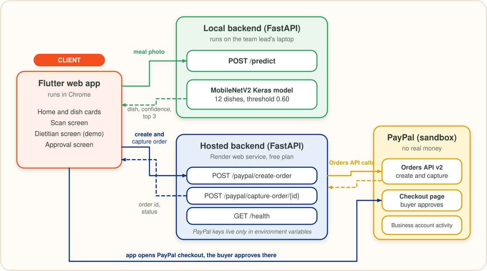
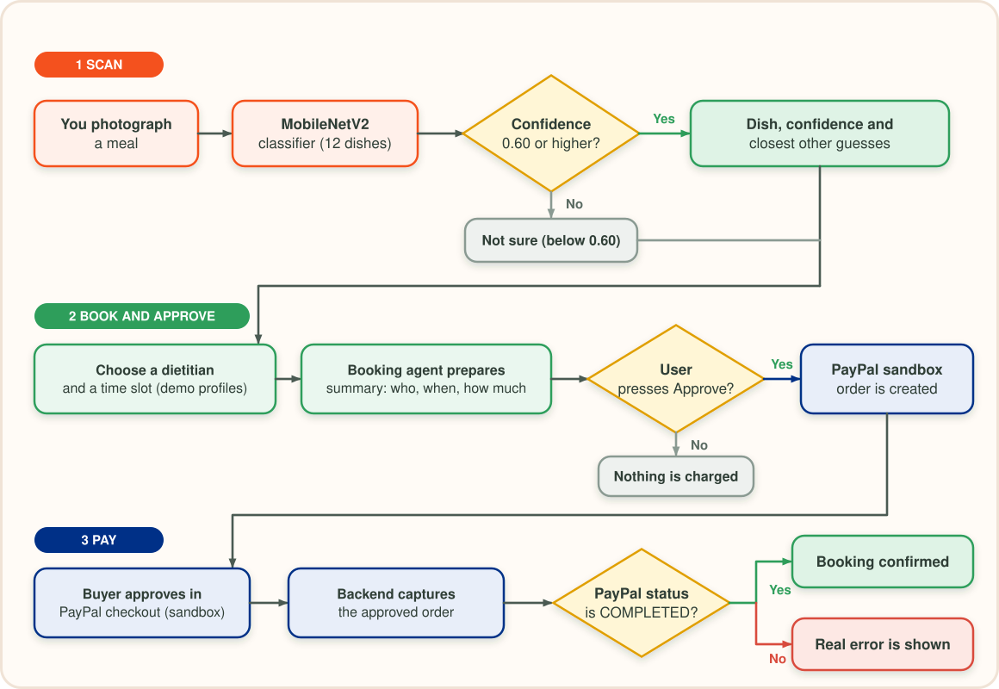
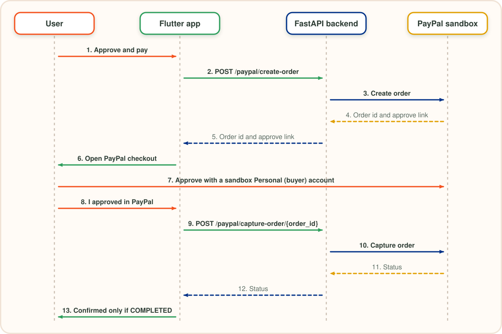

# Architecture

SavorLens has three moving parts: a Flutter web app, a scan backend that runs the food model, and a payment backend that talks to PayPal. They are kept separate on purpose, so the payment flow works even when the model is not available.

## Components

| Component | Where it runs | Responsibility |
|---|---|---|
| Flutter web app | The user's browser (served locally on port 8080) | Home, scan, dietitian and approval screens. Calls both backends. |
| Scan backend | FastAPI on the team lead's laptop (port 8000) | `POST /predict`: loads the MobileNetV2 Keras model and returns the dish, confidence, top guesses and the threshold. |
| Payment backend | FastAPI on Render (free web service) | `POST /paypal/create-order`, `POST /paypal/capture-order/{order_id}` and `GET /health`. |
| PayPal sandbox | PayPal | Orders API v2 for creating and capturing orders, checkout page for the buyer, business account activity. |

The scan backend and the payment backend are the same FastAPI project (`backend/`). On Render the model code and TensorFlow are not installed, so `/predict` switches itself off and `/health` reports `predict_enabled: false`.

## User flow

## Payment sequence

## Design decisions

**1. A human approval gate before any money moves.**
The booking agent only prepares a summary (who, when, how much). The PayPal order is created only after the user presses "Approve and pay", and the booking is confirmed only when PayPal returns `COMPLETED`. If PayPal returns an error, the app shows it.

**2. "Not sure" is a valid answer.**
The classifier answers "not sure" when its top confidence is below 0.60. The threshold was chosen on validation data and is not lowered to make a demo look nicer. See the [model card](MODEL_CARD.md).

**3. The model is optional for the payment backend.**
`main.py` imports the prediction code inside a `try/except ImportError`. If it fails, `/predict` is disabled and the PayPal endpoints keep working. This is what allowed a light deployment on Render (`requirements-paypal.txt`: FastAPI, Uvicorn, httpx and python-dotenv) without TensorFlow.

**4. Secrets stay out of the repository.**
PayPal keys live only in environment variables on Render and in a local `backend/.env`. `.env.example` is committed, `.env` is not.

**5. Demo data is labelled.**
The six dietitian profiles are demo data and are labelled as such in the app. Nutrition values are shown as "not measured yet".

## Deployment

| Part | Deployed on | Notes |
|---|---|---|
| Payment backend | Render web service, free plan | Root directory `backend`. Build: `pip install -r requirements-paypal.txt`. Start: `uvicorn main:app --host 0.0.0.0 --port $PORT`. Environment variables: `PAYPAL_CLIENT_ID`, `PAYPAL_CLIENT_SECRET`, `PAYPAL_BASE_URL`. |
| Scan backend | Local machine | The food model (about 9.8 MB Keras file) is not deployed on the free plan. |
| Flutter app | Local machine | `flutter run -d web-server --web-port 8080` |

The free Render plan sleeps when idle, so the first request after a pause can take about a minute.

## Known limits

- The scan feature needs the local backend running.
- Payments are sandbox only.
- A hosted public demo of the whole flow is not available yet.
